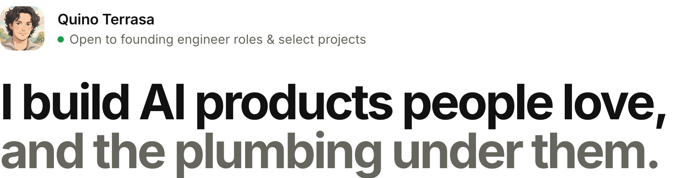
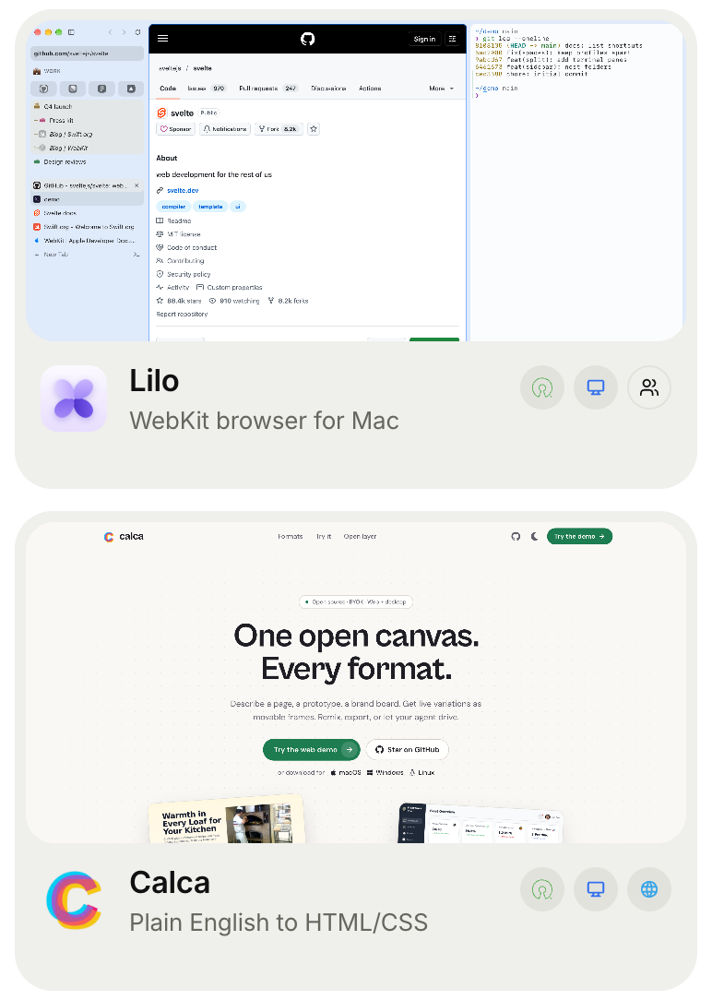
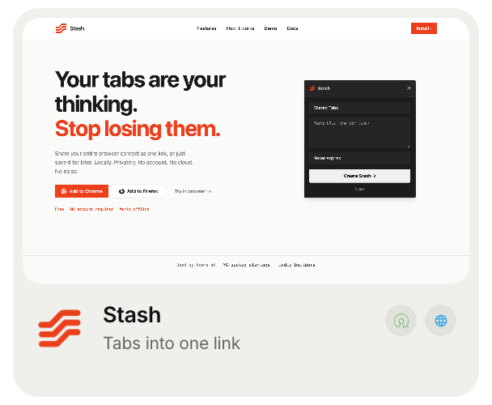
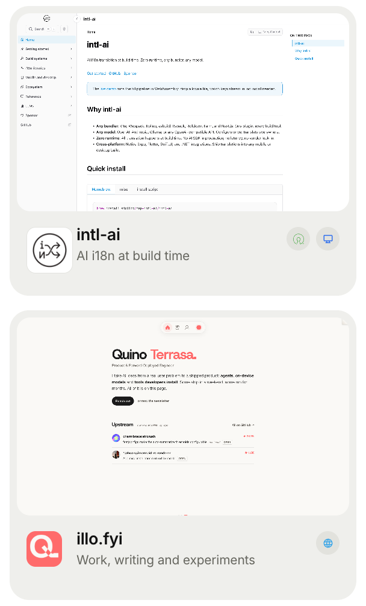
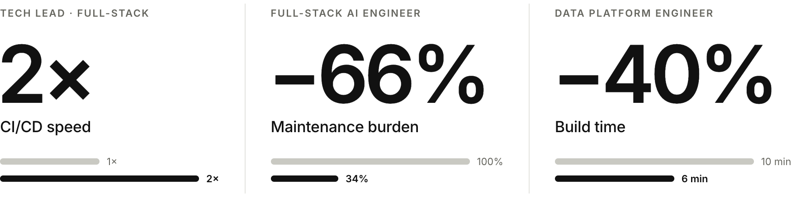
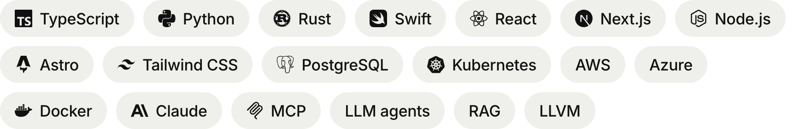

<picture><source media="(prefers-color-scheme: dark)" srcset="assets/hero-dark.png"></picture>

I'm Quino (pronounced /ˈkino/), a product engineer who joins founding teams early and ships the whole thing: AI-first products, taste-level frontends and the unglamorous plumbing underneath. High-agency, end to end, from blank repo to production. The AI is the feature, the craft is the moat.

<a href="mailto:hey@illo.fyi"><picture><source media="(prefers-color-scheme: dark)" srcset="assets/btn-start-dark.png"></picture></a>&nbsp;<a href="https://illo.fyi"><picture><source media="(prefers-color-scheme: dark)" srcset="assets/btn-site-dark.png"></picture></a>

 

<picture><source media="(prefers-color-scheme: dark)" srcset="assets/h-work-dark.png"></picture>

<a href="https://usebrioso.com"><picture><source media="(prefers-color-scheme: dark)" srcset="assets/card-brioso-dark.png"></picture></a><a href="https://getlilo.app"><picture><source media="(prefers-color-scheme: dark)" srcset="assets/col-lilo-calca-dark.png"></picture></a>
<a href="https://stash.illo.fyi"><picture><source media="(prefers-color-scheme: dark)" srcset="assets/card-stash-dark.png"></picture></a><a href="https://cauce.fyi"><picture><source media="(prefers-color-scheme: dark)" srcset="assets/card-cauce-dark.png"></picture></a>
<a href="https://intl-ai.illo.fyi"><picture><source media="(prefers-color-scheme: dark)" srcset="assets/col-intl-illofyi-dark.png"></picture></a><a href="https://pyscriptc.pages.dev"><picture><source media="(prefers-color-scheme: dark)" srcset="assets/card-pyscriptc-dark.png"></picture></a>
[Brioso](https://usebrioso.com) · [Lilo](https://getlilo.app) · [Calca](https://calca.illo.fyi) · [Stash](https://stash.illo.fyi) · [cauce](https://cauce.fyi) · [intl-ai](https://intl-ai.illo.fyi) · [illo.fyi](https://illo.fyi) · [pyscriptc](https://pyscriptc.pages.dev)

More on [illo.fyi](https://illo.fyi), plus [agentplugins](https://github.com/sigilco/agentplugins).

 

<picture><source media="(prefers-color-scheme: dark)" srcset="assets/h-impact-dark.png"></picture>

<picture><source media="(prefers-color-scheme: dark)" srcset="assets/metrics-a-dark.png"></picture>

 

<picture><source media="(prefers-color-scheme: dark)" srcset="assets/h-stack-dark.png"></picture>

<picture><source media="(prefers-color-scheme: dark)" srcset="assets/stack-dark.png"></picture>

 

<picture><source media="(prefers-color-scheme: dark)" srcset="assets/h-contact-dark.png"></picture>

<a href="https://github.com/espetro"><picture><source media="(prefers-color-scheme: dark)" srcset="assets/s-github-dark.png"></picture></a>
<a href="https://linkedin.com/in/quinoterrasa"><picture><source media="(prefers-color-scheme: dark)" srcset="assets/s-linkedin-dark.png"></picture></a>
<a href="https://x.com/josocjoq"><picture><source media="(prefers-color-scheme: dark)" srcset="assets/s-x-dark.png"></picture></a>
<a href="mailto:hey@illo.fyi"><picture><source media="(prefers-color-scheme: dark)" srcset="assets/s-mail-dark.png"></picture></a>
<a href="https://illo.fyi"><picture><source media="(prefers-color-scheme: dark)" srcset="assets/s-site-dark.png"></picture></a>
